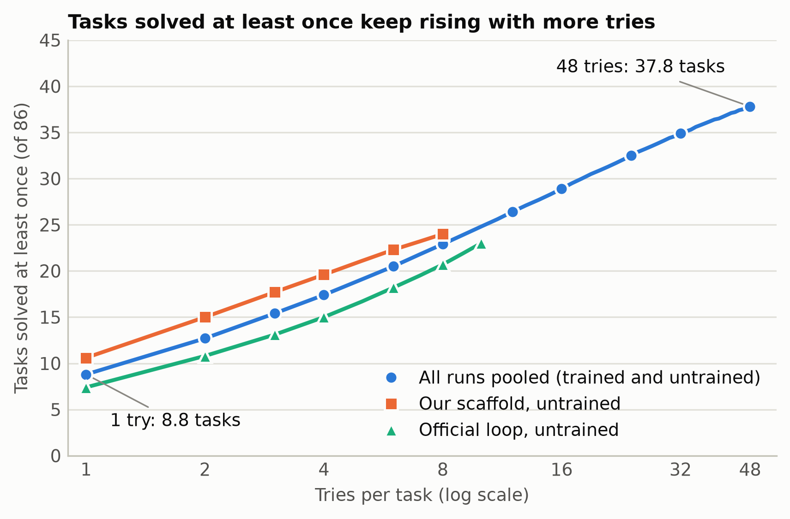
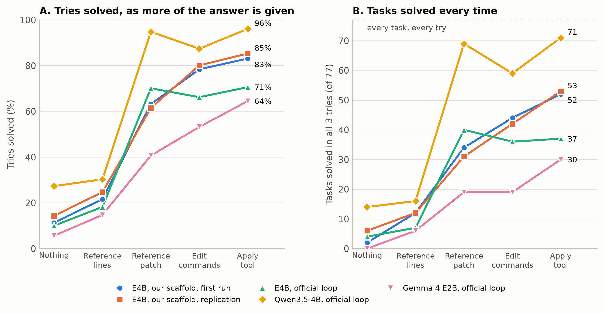
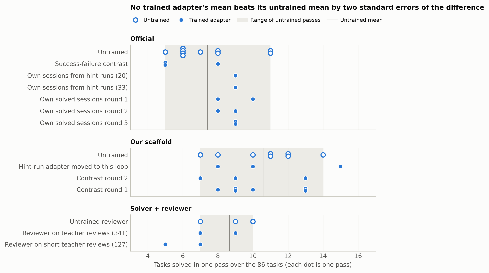

# Can Once, Cannot Reliably

## Given the answer, does a small coding agent act on it?

## Abstract

Gemma 4 E4B, the 4-bit model the Gemma 4 Developer Agent competition scores, solves 10.6 of 86 repository bug-fix tasks at least once with one try and 24.0 with eight. On 77 official tasks, adding the reference lines to the task raises solved tries from 11% to 22%, the reference patch to 63%, ready-made edit commands to 78% and a one-call apply tool to 83%; on the competition's official loop it stops at 71%. E4B's applied fixes passed 278 of 282 times, yet 352 of its 693 tries never called the tool, and at most 53 of 77 tasks were solved in all three tries. On the official loop the rungs separate models: the tool adds 18 solves per pass over the patch for Gemma 4 E2B, which fails most hand edits, and no detectable gain for E4B or for Qwen3.5-4B, which solves 95% with the patch alone. The competition's code graph showed no detectable gain as tools (which cost solves when required) or as a written hint over text alone. The training recipes we tried showed none beyond trained tasks. We release the ladder, its tools and sessions as a benchmark, packaged for Kaggle Benchmarks; there, Gemma 4 31B solves 44% unaided and 96% with the patch.

## 1. Introduction

Coding agents are scored by tasks solved in one try. Eight tries of E4B solve more than twice as many tasks as one: it solves many tasks only sometimes, and the training we tried did not change that. We ask how reliably it acts on help, from a location to the full answer, and in which form.

Contributions:

1. **A ladder of help** (Section 4): five conditions, from no hint to the answer with an apply tool, on two scaffolds and four models.
2. **Code graphs pushed and pulled** (Section 5): the competition's graph as a task hint, a text-only hint or tools.
3. **A released benchmark**, packaged for Kaggle Benchmarks (Section 8).
4. **Diagnosis** (Sections 6 and 7): failed tries without help, and what training changed.

## 2. Setup

**Model and harness.** `gemma-4-e4b-it-qat-w4a16-ct` on vLLM 0.19.1 (temperature 1.0, top-p 0.95, top-k 40, thinking budget 3,072 tokens) in the competition's `swegemma` 0.2.11 harness on Google ADK, Docker sandbox; 8 minutes and 50 tool calls per session. On the official loop we also ran Gemma 4 E2B (`gemma-4-e2b-it-qat-w4a16-ct`, same settings) and Qwen3.5-4B (`Qwen/Qwen3.5-4B`, bfloat16, `qwen3_coder` tool parser).

**Tasks.** *Official*: 86 of the competition's 129 public SWE-bench-format tasks [7], from fastapi and rich, that pass a gold check in our sandbox; no training data comes from these repositories. *Training*: 422 tasks from 26 other repositories. *FreshSWE-Py*: 663 public tasks. *Frontier*: the 234 single-file training and FreshSWE-Py tasks solved in one to three of four tries of a dedicated untrained run. A *try* is one session; a *pass* is one try on each official task.

**Scaffolds.** *Ours*: one agent with helper scripts for finding, reading, editing and checking code; an applied edit returns its diff and runs the related existing tests. *Official loop*: the competition's agent with only the harness's tools (`run_command`, `read_file`, `edit_file`, `write_file`, `submit_patch`).

**Reference lines.** An edit or patch is *on the reference lines* when a hunk lies within three lines of a reference hunk in the same file, a proxy: 49 of 433 solved official tries do not meet it.

## 3. One try shows a fraction of what the model can do

Averaged over all choices of k tries, our untrained scaffold solves 10.6 official tasks at least once with one try and 24.0 with eight, the official loop 7.4 and 20.7 (Figure 1).

**Figure 1.** Official tasks (of 86) solved at least once against tries per task; the pooled curve mixes all runs, trained and untrained.

## 4. A ladder of help

We added one paragraph to each official task statement, three tries per task per arm: the control says "find this in the repository yourself"; the location arm names the reference files and line ranges, the oracle of earlier work [7, 8]; the next arms give the reference patch (never the tests), the patch as the exact edit commands the scaffold accepts, and the patch with a one-call tool that applies it. Nine tasks with very long patches or new files were excluded. In the first run on our scaffold the first two arms ran interleaved and the others later; a replication ran all five interleaved with new seeds, a third did so on the official loop, with `edit_file` calls as the commands and the tool as `python3 -m apply_fix <task>`, and two more ran that loop with Gemma 4 E2B and Qwen3.5-4B (Table 1).

**Table 1. Solved tries as the agent is given more of the answer. 77 official tasks, three tries per arm and run (Gemma 4 31B: one try, hosted on Kaggle Benchmarks); Figure 2B gives tasks solved in all three tries.**

| Added to the task | E4B, our scaffold, first run | E4B, our scaffold, replication | E4B, official loop | Qwen3.5-4B, official loop | E2B, official loop | Gemma 4 31B, hosted |
|---|---|---|---|---|---|---|
| "Find this in the repository yourself" | 11.3% | 14.3% | 10.0% | 27.3% | 5.6% | 44.2% |
| Reference files and lines | 21.6% | 24.7% | 18.2% | 30.3% | 14.7% | 49.4% |
| Reference patch | 63.2% | 61.5% | 70.1% | 94.8% | 40.7% | 96.1% |
| Patch as ready-made edit commands | 78.4% | 80.1% | 66.2% | 87.4% | 53.2% | 94.8% |
| Patch and a one-call apply tool | 83.1% | 85.3% | 70.6% | 96.1% | 64.5% | 96.1% |

**Figure 2.** The ladder in Table 1 for the local runs (three tries): share of tries solved (A) and tasks solved in all three tries (B).

Paired over the 77 tasks (solves per pass, 95% task-bootstrap intervals), our scaffold's two runs agree: the location adds 8.0 in both (lower bounds +3.0), the patch 32.0 and 28.3 more (+20.7 or more), the commands 11.7 and 14.3 more (+4.3 or more), and the tool's further 3.7 and 4.0 include zero. On the official loop the location adds 6.3 (+2.7 to +10.3) and the patch 40.0 (+32.7 to +47.3); the commands (−3.0) and the tool (+0.3 over the patch) show no detectable gain.

**Three models.** Given the patch, E2B gains 18.3 solves per pass from the tool (+12.7 to +23.7), E4B 0.3 and Qwen3.5-4B 1.0; paired on tasks, the difference from E4B is 18.0 (+10.7 to +25.3), and E2B's commands step also exceeds E4B's (+12.7; +3.3 to +21.0). The traces show why: E2B ran the tool in 114 of 231 tries and its 95 applied fixes passed 94 times, but only 55 of its 136 other tries passed; Qwen3.5-4B ran it in 27, while 210 of its 219 tries without an applied fix passed, leaving the tool little room. Qwen3.5-4B also executes a given patch better than E4B (patch step +9.7 more; +1.7 to +17.3). On one loop, which form of help pays depends on the model; E4B's own gain from the tool on our scaffold (+15.3, +18.3) shows it depends on the scaffold too.

**How E4B fails with the answer.** Final patches making the reference's line changes passed in 1,315 of 1,319 tries; failed tries left part of the fix out, changed it, or submitted nothing. On our scaffold 193 tries never called the tool (148 passed by patching by hand) and 52 called it without effect, 41 because a tool channel rejected the task's shell path (a scaffold defect) and one with a mis-quoted command; on the official loop 72 of 231 called it, and 60 of the 159 that did not failed (20 without a patch).

## 5. The code graph, pushed and pulled

The competition provides, per snapshot, a call graph of functions and classes and a 256-dimensional embedding per node, reachable through three harness tools.

**Graph hint.** With no reference answer, we score each source node by TF-IDF against the task statement, add 0.25 times its neighbours' mean score and 0.25 times its embedding similarity to the ten best text matches (weights chosen on 52 other public tasks), and write the top five symbols into the task, marked as possibly wrong. They cover the reference lines for 25 of the 77 tasks and the reference file for 43; text alone gives 25 and 44.

**Pushed against pulled.** Two interleaved runs on our scaffold (Table 2) compared control, the graph tools, the hint and the reference lines; then control, the hint, a text-only hint (graph weights zero) and the tools with an instruction to use them.

**Table 2. Code-graph help on 77 official tasks, our scaffold, three tries per arm, interleaved.**

| Arm | Run | Solved | First applied edit on the reference lines |
|---|---|---|---|
| Control | 1 / 2 | 12.6 / 15.2% | 39.4 / 35.9% |
| Graph tools offered | 1 | 15.2% | 38.1% |
| Graph tools, told to use them | 2 | 9.5% | 36.8% |
| Graph hint in the task | 1 / 2 | 17.7 / 15.2% | 35.9 / 37.7% |
| Text-only hint | 2 | 13.4% | 36.8% |
| Reference lines | 1 | 20.8% | 77.1% |

Offered the graph tools, the agent called one in 18 of 231 tries (+2.0 solves per pass; −1.7 to +5.7). Told to use them, it called one in 156 of 231 and solved fewer (−4.3; −8.3 to −1.0). The hint's gain did not replicate: +4.0 (−0.3 to +8.7) in run 1, 0.0 (−4.0 to +3.7) in run 2, +2.0 pooled (−1.3 to +5.3; 462 tries per arm). Pooled, the agent follows the hint, right or wrong: where it covers the reference lines, solves rise from 4.8 to 7.5 per pass (+2.7; +0.3 to +5.2) and the first applied edit lands there more often (+3.2; +0.7 to +5.8); elsewhere that edit lands on the reference lines less often (−3.8; −7.8 to −0.3) and solves do not rise (−0.7). The graph shows no detectable gain over text: the text-only hint covers the same 25 tasks (graph minus text +1.3; −2.3 to +5.0). (The reference only classifies tasks.)

## 6. Without help: where failed tries go wrong

**The first applied edit.** For every untrained try on a single-file task we extract where each applied edit landed (Table 3).

**Table 3. Outcome by where the first applied edit lands. Our scaffold, untrained.**

| First applied edit | Training, FreshSWE-Py: share of 3,460 tries | Final patch there | Solved | Official: share of 556 | Final patch there | Solved |
|---|---|---|---|---|---|---|
| On the reference lines | 57% | 98% | 42% | 38% | 99% | 35% |
| Elsewhere | 32% | 5% | 8% | 54% | 5% | 4% |
| No edit applied | 11% | 1% | 1% | 9% | 0% | 0% |

After a first edit elsewhere, one try in twenty ends on the reference lines. Within the 247 tasks with an applied edit in both solved and failed tries, the first edit is on the reference lines in 90% of solved and 47% of failed tries; associations; the location arm is the controlled test.

**Failed against solved tries of one task.** Among 251 single-file tasks with solved and failed tries in our untrained training and FreshSWE-Py sweeps, pairing every failed with every solved try: both final patches are on the reference lines in 44% of pairs (39 to 50), and the failed try submitted nothing in 26% (21 to 30) or changed other lines in 21% (17 to 26). Two language-model annotators (one the assistant that ran this study; verdicts hidden; 7 of 9 shared judgements agreed) labelled 20 such tasks: failed tries changed the same function differently in 45% of pairs (27 to 64), and 9 of 11 failed tries without a patch claim a fix never applied. Of 2,762 failed tries that applied an edit and submitted, the last test evidence was "no existing test broke" in 53%.

## 7. What training changed

**Nineteen adapters.** LoRA adapters (rank 64) trained on own sessions, a 27B teacher's reviews, solved-against-failed contrasts or navigation steps; none of the eleven in Figure 3 beats its loop's untrained mean by two standard errors of the difference. On-policy reinforcement on the frontier tasks, rewarding a final patch on the reference lines, solved 465 of 936 fresh tries (49.7%) against 228 of 468 (48.7%) in a concurrent untrained control.

**Figure 3.** Every complete pass on the official tasks, by arm. Open circles are untrained, filled circles trained.

**Imitating its own successes.** We imitated solved tries cut at the first edit, tool-call tokens weighted four times (a four-task control adapter solved 74 of 80 tries on them; untrained 46). Against untrained tries from earlier runs, an adapter on 100 random frontier tasks solved 66.5% of tries on them against 51.9% (+14.6; +7.1 to +22.1), but 49.6% against 46.9% on 60 held-out tasks (+2.7; −3.7 to +8.9) and 9.3 against 10.2 official solves per pass (its untrained comparison), and one on 283 tasks showed no detectable gain.

**Imitating answer-given tries.** We ran 1,103 tries with the fix given as edit commands on training and FreshSWE-Py tasks and trained on 400 solved ones with the answer removed, as whole tries and as tool calls only. Both adapters collapsed (2.0 and 1.3 official solves per pass against 10.2); the whole-try adapter learned to edit before reading (first call an edit in 235 of 256 tries that edited; tool calls only: 32 of 235; untrained: 1 of 749).

## 8. A released benchmark: does the agent act on what it is given?

We release, for any agent in the competition's format:

- task files for the 77 official tasks at every rung, for both scaffolds and the graph arms, with the agent bundles and graph-hint builder;
- the apply tool (skill script and wheel: `python3 -m apply_fix <task>`);
- 7,623 sessions (events, results, tool calls, final patches) from ten runs of three models, with per-try stage labels;
- `score.py`, which scores a new agent from its results folders and reproduces Table 2 and Table 1's local columns in seconds; the hosted run's report and model calls are included.

An agent is scored by its solved share at each rung and, with three tries, by tasks solved in all of them; the gap between the patch rung and 100% measures execution apart from search.

**Hosted on Kaggle Benchmarks.** The official-loop rungs are packaged as Kaggle Benchmarks tasks (`answer-ladder-all-rungs`) that run the competition's harness and grader without a GPU or Docker, unpacking the task wheels the subprocess sandbox omits. On Kaggle all 77 tasks calibrate (empty patch fails, reference passes). With Gemma 4 31B, one try per task and rung, all 385 sessions ran (Table 1): the location adds 4 solves (−3 to +10), the patch 36 more (+27 to +45), and the commands (−1) and the tool (+0 over the patch) show no detectable gain; like Qwen3.5-4B, it executes a given patch almost always. Of its 92 failures, 62 were 8-minute timeouts, so the lower rungs also reflect provider speed. Notebook: kaggle.com/code/jaejohn/answer-ladder-gemma-4-31b-on-all-five-rungs. Hosted runs use provider sampling.

## 9. Discussion

Given the exact fix, E4B still fails one try in six on our scaffold and three in ten on the official loop, mostly without taking the action that would succeed, by choice or through the interface; without help, it is often not told when it has failed. A tool is a request the agent may ignore: it ignored graph tools in 92% of tries but followed a written hint, right or wrong.

## 10. Related work

Agentless [11] localizes before editing; RepoGraph [12] and LocAgent [13] give larger models repository graphs as context or tools; we compare these channels for a 4B agent. Dente et al. [8] give a small-model pipeline, E4B included, the right files; our location arm runs that oracle inside the agent's loop. Kim et al. [9] find larger agents' failures mostly edit the correct functions; Section 6 finds the same for a 4B agent, and Section 4 shows it persists given the patch. Aleithan et al. [10] show agents exploit solutions written into issues; we measure how reliably. Base models match reinforcement-trained ones at large k [1]; self-training stalls in [2, 4], reinforcement learning helps in [3, 6], and self-distillation can hurt [5].

## 11. Limitations

- Two official repositories; one run each for Qwen3.5-4B and E2B and one hosted try for Gemma 4 31B; the graph arms and Sections 6 and 7 cover E4B on one scaffold. The answer arms need the reference fix, so they measure execution, not a deployable method.
- Three tries per task, arm and run; graph-hint weights were tuned on public tasks from the same repositories.
- Training is compared with untrained tries from earlier runs; reinforcement rewarded location, not correctness.

## Data and code availability

Benchmark: kaggle.com/datasets/jaejohn/answer-ladder. Code, data, labels, scripts and `REPRODUCE.md`: github.com/raojohng/answer-ladder.

## References

1. Yue et al. Does Reinforcement Learning Really Incentivize Reasoning Capacity in LLMs Beyond the Base Model? arXiv:2504.13837.
2. Pan et al. SWE-Gym. arXiv:2412.21139.
3. Golubev et al. Training Long-Context, Multi-Turn Software Engineering Agents with Reinforcement Learning. arXiv:2508.03501.
4. Lauffer et al. Imitation Learning for Multi-turn LM Agents via On-policy Expert Corrections. arXiv:2512.14895.
5. Su et al. From Self-Distillation to Self-Practice. arXiv:2609.29051.
6. Kim, Shi, et al. FrogNano. arXiv:2609.07925.
7. Jimenez et al. SWE-bench. arXiv:2310.06770.
8. Dente et al. Who Should Own the Loop? AgenticDev '26. doi:10.1145/3843282.3844442.
9. Kim, Wang, et al. Coherence Collapse. arXiv:2603.24631.
10. Aleithan et al. SWE-Bench+. arXiv:2410.06992.
11. Xia et al. Agentless. arXiv:2407.01489.
12. Ouyang et al. RepoGraph: Enhancing AI Software Engineering with Repository-level Code Graph. ICLR 2025, arXiv:2410.14684.
13. Chen et al. LocAgent: Graph-Guided LLM Agents for Code Localization. arXiv:2503.09089.
